<p align="center">
  
</p>

# git-carpet

Weave a Persian carpet from your GitHub activity. The carpet is an animated SVG for your profile README. It rests, the loom takes it back, and then it is woven again row by row from the bottom, the way a real rug grows on a loom.

Every carpet keeps the symmetry of a Persian city rug (Kashan, Tabriz, Isfahan, Nain, Heriz). Only one quarter of the design is computed, and the rest is its mirror image left↔right and top↔bottom. A test checks this on every build.

## Gallery

The carpets below are woven from made-up profiles.

### Five city harmonies

Your top language and your login pick one of five palettes, each modeled on a weaving city.

<table>
  <tr>
    <td align="center"><br /><sub><b>Kashan</b><br />madder field, indigo border</sub></td>
    <td align="center"><br /><sub><b>Tabriz</b><br />ivory field, madder border</sub></td>
    <td align="center"><br /><sub><b>Isfahan</b><br />indigo field, madder border</sub></td>
    <td align="center"><br /><sub><b>Nain</b><br />ivory field, indigo border</sub></td>
    <td align="center"><br /><sub><b>Heriz</b><br />pomegranate field, indigo border</sub></td>
  </tr>
</table>

### Quiet to prolific

These three share a login, so they use the same palette, and only the activity differs.

<table>
  <tr>
    <td align="center"><br /><sub><b>Quiet</b><br />40 contributions · 3-day streak · 1-year-old account</sub></td>
    <td align="center"><br /><sub><b>Steady</b><br />600 contributions · 35-day streak · 7 years</sub></td>
    <td align="center"><br /><sub><b>Prolific</b><br />4,200 contributions · 120-day streak · 13 years</sub></td>
  </tr>
</table>

To re-weave the gallery after a design change, run `node examples/gallery.js`.

## Use it

Add this workflow to your profile repository (the one named after your username) as `.github/workflows/carpet.yml`:

```yaml
name: Carpet
on:
  schedule:
    - cron: "40 1 * * *"
  workflow_dispatch:
permissions:
  contents: write
jobs:
  weave:
    runs-on: ubuntu-latest
    steps:
      - uses: actions/checkout@v7
      - uses: AlirezaAzadbakht/git-carpet@v0
```

Run it once from the Actions tab, then show the carpet in your `README.md`:

```html

```

| Input | Default | |
|---|---|---|
| `user` | repository owner | Account whose carpet to weave |
| `output-dir` | `carpet` | Folder that receives `carpet.svg` |
| `commit` | `true` | Commit and push the SVG when it changes |
| `commit-message` | `carpet: weave the day's carpet` | |
| `github-token` | `${{ github.token }}` | The built-in token is enough; only public data is read |

## How your activity becomes a carpet

Activity changes the carpet a lot. A quiet year weaves a calm, open rug, and a busy one weaves a dense, gilded one.

| Part of the rug | Quiet profile | Busy profile | Comes from |
|---|---|---|---|
| Field (matn) | Open ground with scattered flowers | Leaves, then the herati lattice, then florets on every crossing | Contributions in the last year |
| Central medallion (toranj) | Small, plain star | Large, with a petal ring, an inner lobed frame and pendants | Contributions in the last year |
| Gold thread | None | Gold vine from a 30-day streak; gold rosettes and medallion band from 90 days | Longest daily streak |
| Main border (hashiyeh) | A few rosettes | More rosettes, closer together | Longest daily streak |
| Outer frame | One guard and one stripe | Up to three stripes, plus a second interlocking-tooth guard after 8 years | Account age |
| Color harmony | | | Your top language and your login |
| Abrash: soft bands of shade | | | Each week of the last year, woven bottom to top. Busy weeks are a richer dye, quiet weeks a lighter one, the way real rugs show dye batches |

Every color is a natural dye: madder, indigo, ivory, saffron, walnut, pistachio, pomegranate. The same account on the same day always gives the same carpet.

## Locally

```bash
node src/cli.js <login>          # writes carpet/carpet.svg (uses `gh auth token` if present)
node src/cli.js --fixture test/fixtures/busy.json --out /tmp/rug
node test/check.js               # symmetry, determinism, size budget
```

There are no dependencies and no build step. Node 20 or newer is enough.

## License

MIT
